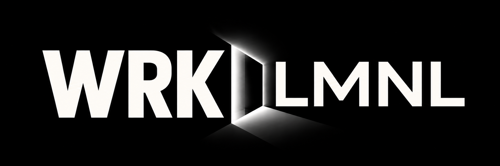
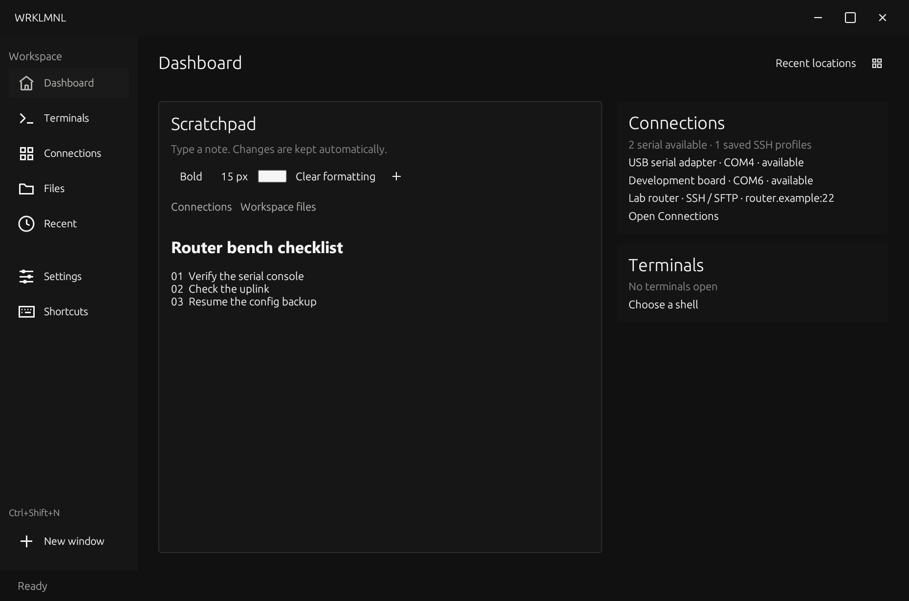
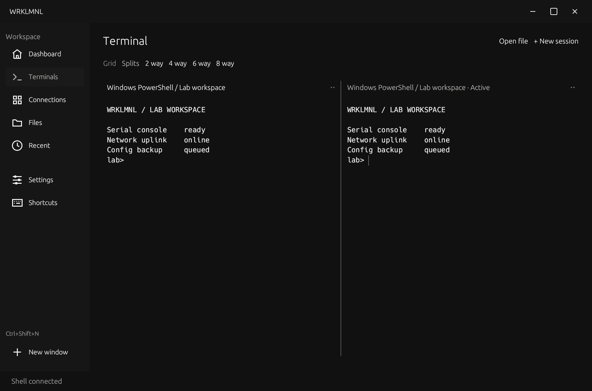
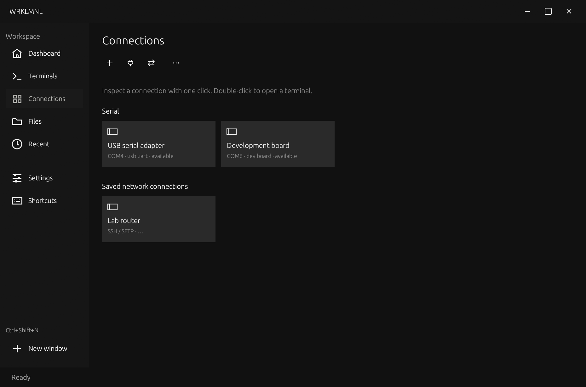
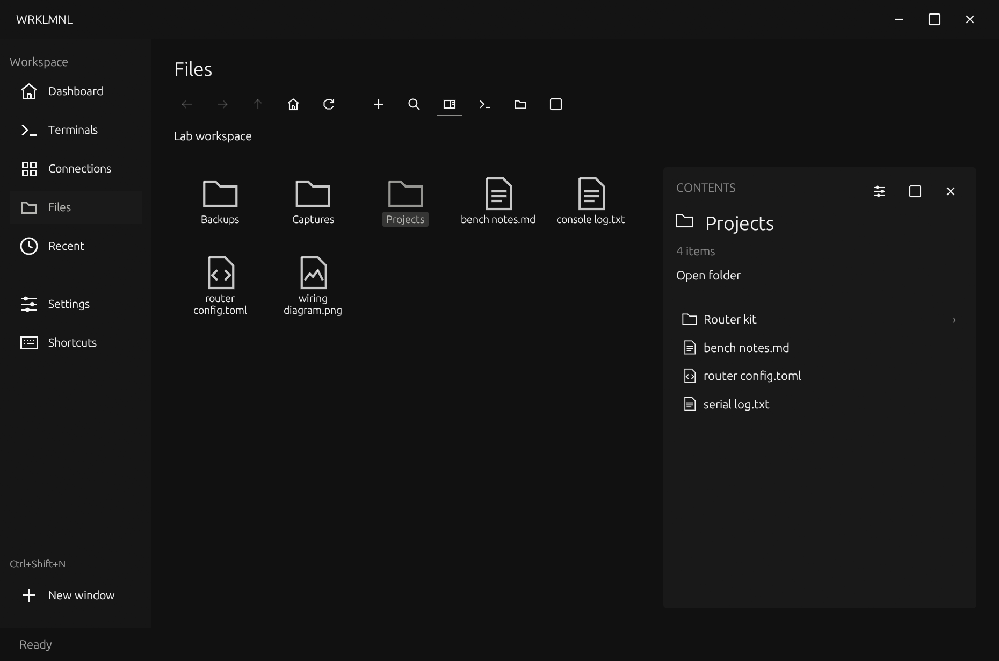

# WRKLMNL



A native workspace for your files, shells, and connections. Point it at your desktop or any folder you already use.

| Dashboard | Terminals |
| --- | --- |
| [](docs/media/dashboard.png) | [](docs/media/terminals.png) |
| **Connections** | **Files** |
| [](docs/media/connections.png) | [](docs/media/files.png) |

## Start with a folder

Open WRKLMNL, then choose a folder in **Settings → Workspace**. On Windows, launch the executable from the [latest build](https://github.com/dustindwayne/wrklmnl/releases/latest). **Use Desktop** points the app at your system Desktop.

## Dashboard

Keep notes in the scratchpad and add formatting or links to files, folders, and app pages. Notes save automatically. Connections and terminal sessions sit beside the scratchpad. Select **Arrange dashboard** to give another module the wider column or move it to the other side.

## Terminals

Open local shells in tabs or split the window into panes. Add a shell in **Settings → Custom shells** to give it a working folder and startup arguments.

## Connections

Inspect detected serial devices and available driver details. Open serial, SSH, and Telnet sessions from the same screen, and save SSH profiles for destinations you revisit.

Open **File transfer** to browse local and remote folders side by side. SFTP uploads and downloads can resume after a connection drops. SSH and SFTP use trusted host keys and authenticate with a private key or the system SSH agent.

## Files

Browse your workspace as a desktop canvas. Drag items to move them, open a folder in **Contents**, or preview a file beside the canvas. Lightweight text files can be edited in place. Open **Properties** for the path, name, timestamps, and permissions.

## Recent, Settings, and Shortcuts

Reopen a folder from **Recent**. Use **Settings → Layout** to change the order of dashboard modules and sidebar items. The layout saves automatically.

Under **Settings → Appearance**, choose **Basic** for the standard look or **pixel_tech** for charcoal circuit artwork. **Dark** and **Light** are separate from the theme. One accent controls selection, focus, and primary actions. In **Backgrounds**, replace either bar image or switch it to solid, then apply your changes.

See [keyboard shortcuts](KEYBINDINGS.md) for navigation and terminal controls.

## Build from source

### Windows

Use the Rust MSVC toolchain, Visual Studio C++ Build Tools, and a Windows SDK. The SDK supplies the resource compiler for the launcher icon. The [Windows workflow](.github/workflows/windows.yml) tests and builds the x64 release executable using Rust 1.99.1.

```powershell
cargo test --locked --workspace
cargo build --locked --release --bin WRKLMNL
.\target\release\WRKLMNL.exe
```

### Linux

The x86-64 source build was verified previously on Ubuntu with Rust 1.91.1. Install a C compiler, `pkg-config`, and the libudev development headers. Run the app from an X11 or Wayland graphical session with OpenGL support. Under WSL, use the Linux filesystem for file-move tests.

```bash
cargo test --locked --workspace
cargo build --locked --release --bin WRKLMNL
./target/release/WRKLMNL
```

### macOS

Install the Xcode Command Line Tools and a native Rust toolchain for Apple Silicon or Intel. Run the same Cargo build from a macOS graphical session. The command produces a native executable in `target/release`. The macOS build is unverified.

```bash
cargo test --locked --workspace
cargo build --locked --release --bin WRKLMNL
./target/release/WRKLMNL
```

## Licenses

WRKLMNL has no project-wide open-source license. Third-party components keep their own terms. See the [Windows third-party notices](THIRD_PARTY_NOTICES.txt) and the [distribution guide](docs/distribution.md) for the bundled fonts, Rust standard library notices, and the corresponding source for MPL-covered dependencies.

## Source layout

- [Desktop app](crates/terminal) contains the dashboard, terminals, connections, Files, and Settings.
- [Graphics](crates/graphics), [UI components](crates/ui), and [layout parsing](crates/language) are shared workspace crates.
- [Vendored eframe patch](vendor/eframe/DTERM-PATCH.md) describes local window integration changes.
- [Third-party icon notices](assets/icons/LICENSE) and the [vendored eframe license](vendor/eframe/LICENSE-MIT) cover those bundled components.
