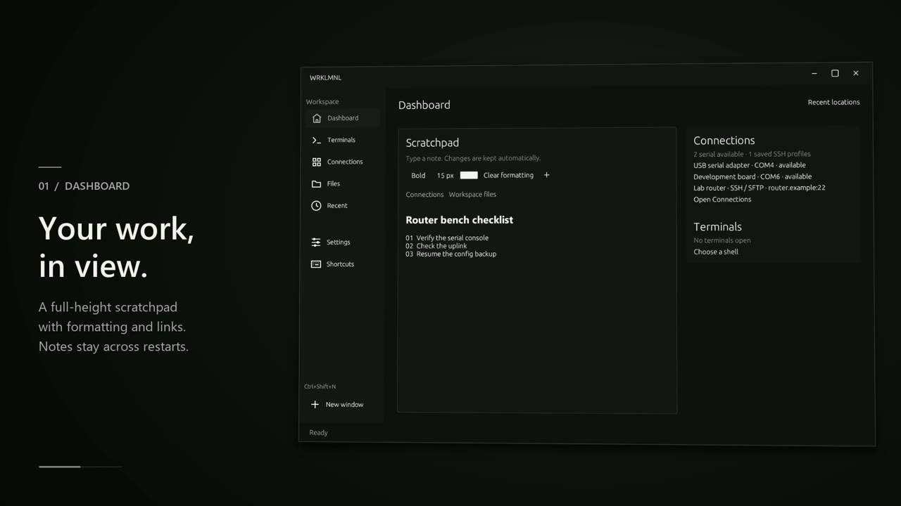

# WRKLMNL


WRKLMNL is a native workspace for Windows and Linux for terminals, connections, and files. Use your existing desktop folder or choose any workspace folder, then keep shells, devices, file transfers, and notes together in one window.

[](docs/media/WRKLMNL-feature-highlight.mp4)

## What you can do

| Area | Features |
| --- | --- |
| Dashboard | Write in a full-height scratchpad with automatic saving, text formatting, and links to files, folders, and app pages. See connections and terminal sessions alongside it. |
| Terminals | Open multiple local shells in tabs or split panes. Add custom shells with their own executable, startup arguments, and working folder. |
| Connections | Discover serial devices and inspect connection and driver details where available. Open serial, SSH, or Telnet sessions and reuse saved SSH profiles. |
| File transfer | Browse local and remote folders side by side. Resume interrupted SFTP uploads and downloads from checked partial files. |
| Files | Browse a visual desktop canvas, move items by dragging them, inspect properties, and preview or edit lightweight text files. Open files in the app or with the system default. |

## Getting started

1. Launch `WRKLMNL.exe`.
2. Open **Settings → Workspace location** and choose a folder. **Use Desktop** selects the system Desktop. On first launch, WRKLMNL prefers an existing **Organized Desktop** folder inside Desktop.
3. Open **Files** to browse the workspace, **Terminals** to start a shell, or **Connections** to connect to a device or host.

For SSH and SFTP, set up a trusted host key and authenticate with a private key or the system SSH agent. In **Connections → File transfer**, choose a saved SSH profile and select **Browse remote**.

See [keyboard shortcuts](KEYBINDINGS.md) for navigation and terminal controls.

## Build from source

The Windows build uses the Rust MSVC toolchain and the Visual Studio C++ Build Tools with a Windows SDK. The SDK supplies the resource compiler for the launcher icon. The build has been verified with Rust 1.99.1.

```powershell
cargo fmt --all -- --check
cargo test --locked --workspace
cargo build --locked --release --bin WRKLMNL
```

Launch `target\release\WRKLMNL.exe`. The build produces one desktop executable.

### Linux

The x86-64 Linux build was verified on Ubuntu with Rust 1.91.1. Install a C compiler, `pkg-config`, and the libudev development headers. The desktop needs a graphical session with OpenGL support.

```bash
cargo test --locked --workspace
cargo build --locked --release --bin WRKLMNL
./target/release/WRKLMNL
```

## Source layout

- [Desktop app](crates/terminal) contains the dashboard, terminals, connections, file browser, and settings.
- [Graphics](crates/graphics), [UI components](crates/ui), and [layout parsing](crates/language) are workspace crates used by the app.
- [Vendored eframe patch](vendor/eframe/DTERM-PATCH.md) describes the local window integration changes.
- [Third-party icon notices](assets/icons/LICENSE) and the [vendored eframe license](vendor/eframe/LICENSE-MIT) cover those bundled components.
